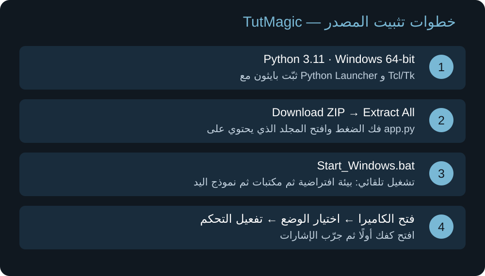

# TutMagic

Windows desktop mouse and presentation control using hand gestures, with an Arabic interface.
صدقة جارية على روح ابى وحبيبي محمود البلال
**Version:** 0.4.0 · **Platform:** Windows 10/11 (64-bit) · **Python:** 3.11 (64-bit)

## الشرح العربي بالصور

**ابدأ هنا:** [التثبيت خطوة بخطوة](docs/INSTALL_AR.md) · [الاستخدام والإشارات بالصور](docs/USAGE_AR.md) 



هذه نسخة المصدر لويندوز. تشغيلها يحتاج Python 3.11؛ أما نسخة EXE المحمولة فتُبنى وتُختبر على Windows كما يوضح الدليل. الرسومات توضيحية وليست لقطات شاشة فعلية.

## Features

- Webcam hand tracking using MediaPipe.
- Mouse movement, clicking, dragging and scrolling.
- Presentation navigation and volume controls.
- Custom gesture bindings, settings import/export and a system tray icon.
- Local camera processing. See [privacy information](PRIVACY_AR.md).

## Quick start

1. Install Python 3.11 (64-bit) for Windows, including Python Launcher and Tcl/Tk.
2. Download and extract this repository, or clone it.
3. Run `Start_Windows.bat`. Initial setup installs dependencies and downloads the MediaPipe hand model; internet access is required.
4. Open the camera, select a mode, and explicitly enable control. Open your hand first to arm gesture recognition.

F8 toggles control; an open palm stops control. Commands affect the active window. Read the [Arabic guide](README_AR.md) before use.

## Build a Windows application

Run `Build_EXE.bat` on Windows. The executable is created at `dist/TutMagic/TutMagic.exe`.
Run `Package_Windows.bat` to prepare the distribution package. Distribute the complete package, not only the executable.

## Documentation

- [Detailed Arabic instructions](README_AR.md)
- [Changelog](CHANGELOG.md)
- [Release checklist](RELEASE_CHECKLIST_AR.md)
- [Third-party notices](THIRD_PARTY_NOTICES.md)

## Development

Tests are in `tests/`. With dependencies installed, run:

```console
python -m unittest discover -s tests -v
```

Some tests require a graphical desktop and application dependencies. Camera operation and Windows executable builds require separate testing on Windows.

## License

Original project code is covered by [MIT](LICENSE.txt). Third-party libraries and model assets retain their own licenses.
