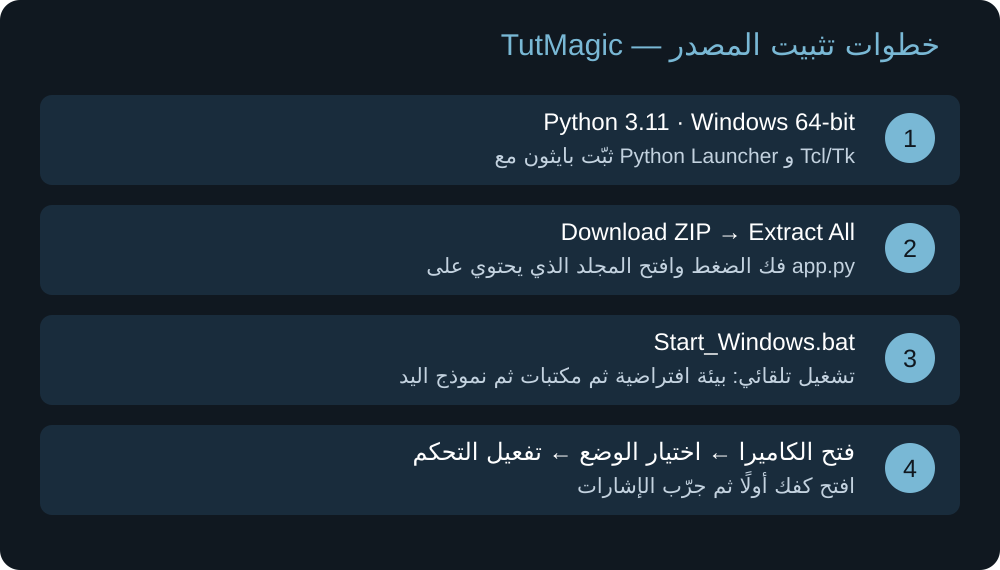
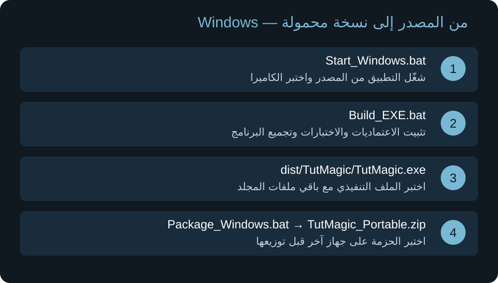

# دليل تثبيت TutMagic على Windows

[الصفحة الرئيسية](../README.md) · [الاستخدام بالصور](USAGE_AR.md) · [رفع المشروع](UPLOAD_AR.md)

> الرسومات هنا توضيحية للخطوات وليست لقطات شاشة من ويندوز. هذه الحزمة تحتوي على المصدر، ولا تحتوي على EXE جاهز.



## 1. المتطلبات

- Windows 10/11 بنظام 64-bit.
- Python 3.11 بنظام 64-bit، مع Python Launcher وTcl/Tk.
- كاميرا تعمل على الجهاز، وإنترنت لأول إعداد لتنزيل المكتبات ونموذج اليد.
- فك ضغط جميع ملفات المشروع مع المحافظة على مجلدات assets وtests وdocs.

## 2. تثبيت Python والتحقق منه

افتح [موقع Python الرسمي لويندوز](https://www.python.org/downloads/windows/) واختر إصدارًا من سلسلة 3.11 بنظام 64-bit متوافقًا مع المشروع. لا تختَر الحزمة Embeddable. عند استخدام المثبّت التقليدي، أبقِ pip وTcl/Tk وPython Launcher ضمن المكونات، وفعّل إضافة Python إلى PATH إذا ظهر الخيار. لا يلزم حذف إصدارات Python الأخرى.

افتح Command Prompt واكتب:

```bat
py -3.11 --version
py -3.11 -c "import struct, tkinter; print(struct.calcsize('P') * 8)"
```

يجب أن يعرض الأول `Python 3.11.x` والثاني `64`. إذا لم يُعرف الأمر `py`، تأكد من تثبيت Python Launcher وأعد فتح نافذة الأوامر.

## 3. تنزيل المصدر وفك الضغط

1. افتح [المستودع](https://github.com/Bioabdo767/TutMagic.).
2. بعد رفع الملفات، اضغط **Code → Download ZIP**.
3. اضغط بزر الفأرة الأيمن على الملف ثم **Extract All**.
4. ادخل إلى المجلد الذي ترى فيه `app.py` و`Start_Windows.bat` مباشرة؛ اسم المجلد الخارجي قد يختلف عند التنزيل من GitHub.
5. لا تشغّل الملفات من داخل نافذة ZIP.

## 4. التشغيل التلقائي

اضغط مرتين على `Start_Windows.bat`. يقوم الملف الموجود بالمشروع بالترتيب التالي:

1. إنشاء بيئة Python داخل `.venv` إذا لم تكن موجودة.
2. التأكد من أن إصدارها 3.11.
3. اختبار استيراد المكتبات وتثبيتها عند الحاجة من `requirements.txt`.
4. تنزيل `hand_landmarker.task` إذا لم يكن موجودًا.
5. تشغيل `app.py`.

انتظر اكتمال أول إعداد. في مرات التشغيل التالية افتح نفس الملف. إذا توقف، اقرأ أول رسالة خطأ في نافذة الأوامر؛ لا تفترض أن الإعداد اكتمل.

## 5. التشغيل اليدوي عند الحاجة

افتح **Command Prompt** داخل مجلد المشروع، ثم نفّذ الأوامر واحدًا بعد الآخر. توقف إذا فشل أي أمر:

```bat
py -3.11 -m venv .venv
.venv\Scripts\python.exe -m pip install -r requirements.txt
.venv\Scripts\python.exe setup_model.py
.venv\Scripts\python.exe app.py
```

لا تحتاج إلى تفعيل البيئة يدويًا لأن الأوامر تستخدم Python الموجود داخلها مباشرة.

## 6. أول تجربة

افتح الكاميرا من التطبيق، واختر وضع الماوس أو الشرح. ابدأ بتجربة بدون تنفيذ إن أردت التعرف على الإشارات أولًا. عند تفعيل التحكم افتح الأصابع أولًا، ثم جرّب حركة السبابة. اضغط F8 لإيقاف التحكم أو افتح كفك وثبّته لحظة. راجع [شرح الحركات](USAGE_AR.md).

## 7. بناء EXE ونسخة محمولة



هذه الخطوات تنفَّذ على Windows بعد نجاح تشغيل المصدر:

1. شغّل `Build_EXE.bat`. يعيد تثبيت المتطلبات، ويتحقق منها ويشغّل الاختبارات، ثم يجمع البرنامج بواسطة PyInstaller. يتوقف إذا حدث خطأ.
2. الناتج هو `dist\TutMagic\TutMagic.exe`.
3. احتفظ بمجلد `dist\TutMagic` كاملًا؛ ملف EXE وحده غير كافٍ.
4. اختبر الكاميرا والإشارات والواجهة وF8 والتصغير والخروج.
5. شغّل `Package_Windows.bat` لإنشاء `TutMagic_Portable.zip` مع الوثائق والتراخيص.
6. جرّب فك الحزمة على جهاز Windows آخر لا يحتوي على Python قبل توزيعها.

مستخدم الحزمة المحمولة المكتملة لا يحتاج إلى تثبيت Python: يفك الضغط بالكامل ويشغّل `TutMagic.exe`. هذا يخص حزمة EXE التي تبنيها وتختبرها لاحقًا؛ ملف **Source code (zip)** ليس نسخة تنفيذية.

## 8. حل المشكلات

| المشكلة | ما الذي تجربه؟ |
|---|---|
| Python 3.11 is required | تحقق باستخدام `py -3.11 --version`. إذا كانت `.venv` مبنية بإصدار آخر، أغلق التطبيق وأعد تسميتها إلى `.venv-old` ثم أعد التشغيل. |
| فشل تثبيت مكتبة | راجع أول خطأ واتصال الإنترنت وإصدار Python ومعمارية 64-bit، ثم أعد أمر تثبيت المتطلبات. |
| فشل تنزيل النموذج | تحقق من الاتصال وإتاحة تنزيل النموذج من Google، ثم أعد تشغيل `setup_model.py`. |
| الكاميرا لا تفتح | أغلق البرامج الأخرى التي تستخدمها، وتحقق من إذن الكاميرا لتطبيقات سطح المكتب ومن الكاميرا المختارة داخل التطبيق. |
| تظهر اليد لكن لا يحدث تحكم | تحقق من تفعيل التحكم واختيار وضع التنفيذ، وافتح كفك أولًا ثم جرّب الإشارة؛ الأوامر تذهب للنافذة النشطة. |
| المؤشر يهتز | حسّن الإضاءة وثبّت الكاميرا واضبط التنعيم تدريجيًا من الإعدادات. |
| نافذة التطبيق اختفت بعد التصغير | ابحث عن الأيقونة بجوار الساعة أو داخل الأيقونات المخفية. |
| EXE لا يعمل بعد نقله | انقل المجلد الكامل بدل EXE وحده، وراجع رسالة الخطأ والتراخيص وقائمة اختبار الإصدار. |

إعداداتك الشخصية محفوظة عادةً في `%LOCALAPPDATA%\TutMagic\settings.json`؛ احتفظ بنسخة قبل تغييرها. هذه نسخة تجريبية؛ لم يتم اختبار الكاميرا أو بناء EXE على Windows ضمن إعداد هذا الدليل.
