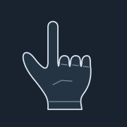
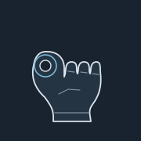
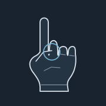
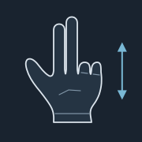
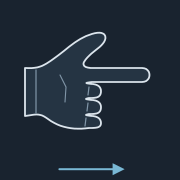
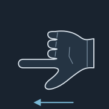
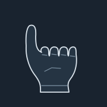

# استخدام TutMagic بالصور

[الصفحة الرئيسية](../README.md) · [دليل التثبيت](INSTALL_AR.md)

الصور التالية رسومات أوضاع اليد المستخدمة في المشروع، وليست صورًا فوتوغرافية أو لقطات شاشة. تعرض الوظائف الافتراضية؛ بعد التخصيص، راجع الدليل داخل التطبيق لمعرفة وظائفك الحالية.

## قبل بدء التحكم

1. ضع الكاميرا أمامك في إضاءة واضحة وأظهر اليد كاملة.
2. افتح الكاميرا واختر وضع **الماوس** أو **الشرح**.
3. جرّب وضع عدم التنفيذ أولًا إذا رغبت، ثم فعّل التحكم بزر التفعيل أو F8.
4. افتح الكف أولًا لتجهيز التعرف قبل تنفيذ الكليك.
5. انتقل إلى النافذة التي تريد التحكم فيها؛ الأوامر تذهب للنافذة النشطة.

## الإشارات الافتراضية

### سبابة لأعلى

- **وضع الماوس:** تحريك المؤشر.
- **وضع الشرح:** بدون أمر.

### ضم الإبهام والسبابة

- **وضع الماوس:** نقر أيسر.
- **وضع الشرح:** تشغيل / إيقاف • Space.

ضم ثم افتح لتنفيذ النقرة. استمرار الضم يبدأ السحب بعد المدة المحددة في وضع الماوس، والفتح يترك العنصر. الضم مرتين ينتج نقرتين؛ احتسابهما كنقرة مزدوجة يعتمد على إعدادات Windows.

### ضم الإبهام والوسطى

- **وضع الماوس:** نقر أيمن.
- **وضع الشرح:** بدون أمر.

### سبابة ووسطى

- **وضع الماوس:** تمرير رأسي.
- **وضع الشرح:** بدون أمر.

ارفع السبابة والوسطى مع قفل بقية الأصابع، ثم حرّك اليد رأسيًا للتمرير.

### سبابة لليمين

- **وضع الماوس:** تحريك المؤشر.
- **وضع الشرح:** التالي • سهم يمين.

### سبابة لليسار

- **وضع الماوس:** تحريك المؤشر.
- **وضع الشرح:** السابق • سهم يسار.

### إبهام لأعلى

- **وضع الماوس:** بدون أمر.
- **وضع الشرح:** رفع الصوت.

### إبهام لأسفل

- **وضع الماوس:** بدون أمر.
- **وضع الشرح:** خفض الصوت.

### كف مفتوح

- **وضع الماوس:** إيقاف التحكم.
- **وضع الشرح:** إيقاف التحكم.

ثبّت الكف المفتوح لحظة لإيقاف التحكم. يمكنك أيضًا الضغط على F8.

## تخصيص الإشارات

افتح **الحركات والوظائف**، وحدد الماوس أو الشرح، ثم عدّل وظيفة موجودة أو اختر **إضافة حركة**. اكتب اسمها وحدد مفرود/مقفول لكل من السبابة والوسطى والبنصر والخنصر، ثم الوظيفة واحفظ. أبقِ الإبهام بعيدًا عن ضم السبابة أو الوسطى. الكف المفتوح محجوز للإيقاف؛ لا تكرر وضع الأصابع نفسه داخل وضع التحكم نفسه.

هذه قواعد لأوضاع أصابع ثابتة وليست تدريبًا لنموذج جديد بالفيديو. الحفظ يوقف التحكم؛ راجع التخصيص ثم أعد التفعيل.

## ضبط الاستجابة

غيّر قيمة واحدة في كل مرة ثم جرّبها: حساسية الضم للكليك، وزمن بدء السحب، وزمن تأكيد الإشارة، والتنعيم ومساحة الحركة والتمرير. إذا بدأ السحب مبكرًا، زد زمنه. إذا اهتز المؤشر، حسّن الإضاءة واضبط التنعيم. استخدم تصدير الإعدادات قبل تغييرات كبيرة، واستورد النسخة لاحقًا عند الحاجة.

## التصغير والخروج والخصوصية

التصغير ينقل التطبيق إلى أيقونة بجوار الساعة؛ قد تستمر الكاميرا والتحكم أثناء التصغير. للإيقاف استخدم F8 أو الكف المفتوح، ولإنهاء التطبيق استخدم زر X أو الخروج من الأيقونة. المعالجة محلية؛ أول إعداد يحتاج الإنترنت لتنزيل المكتبات والنموذج. اقرأ [سياسة الخصوصية](../PRIVACY_AR.md).

التطبيق مصمم ليد واحدة والشاشة الأساسية. الإضاءة والكاميرا ووضع اليد تؤثر في التعرف. افتح `QUICK_START_AR.html` محليًا لعرض الدليل الرسومي الموجود مع المشروع دون اتصال بعد تنزيله.
